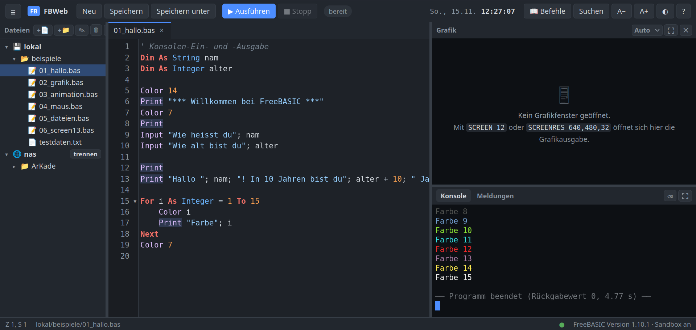

# FBWeb – FreeBASIC im Browser / FreeBASIC in the browser



**[Deutsch](#deutsch)** · **[English](#english)** · **[Download (.deb)](../../releases/latest)**

---

## Deutsch

FBWeb ist eine Web-IDE für [FreeBASIC](https://www.freebasic.net). Sie läuft auf einem
Linux-Server (Debian/Ubuntu) und wird komplett im Browser bedient – Programme schreiben,
übersetzen und ausführen, inklusive **Grafik**, ganz ohne X-Server und ohne VNC.

### Funktionen

- **Editor** mit FreeBASIC-Syntaxfarben, Zeilennummern, Einrückung, Code-Faltung,
  Suchen/Ersetzen, Autovervollständigung und mehreren Tabs
- **Konsole** (xterm.js) für `PRINT`, `INPUT`, `LINE INPUT`, `INKEY`, `COLOR`, `LOCATE` …
- **Grafik** (`SCREEN`, `SCREENRES`, `LINE`, `CIRCLE`, `PSET`, `PAINT`, `DRAW`, Paletten,
  `SCREENLOCK`, Seiten) direkt im Browser-Canvas, mit Tastatur (`INKEY`, `MULTIKEY`,
  `GETKEY`) und Maus (`GETMOUSE`, `SCREENEVENT`)
- **Dateien**: Laden/Speichern/Hochladen/Herunterladen, lokale Laufwerke und
  **sshfs-Freigaben** per Konfiguration
- **Sandbox**: Programme laufen als Benutzer `fbrun` in bubblewrap und sehen nur
  `/usr` und die konfigurierten Laufwerke
- Läuft komplett offline (CodeMirror und xterm.js sind enthalten)

### Installation (.deb-Paket)

Voraussetzung: Ubuntu 22.04 oder neuer bzw. Debian 12 oder neuer, x86_64.
Das Paket gibt es unter **[Releases](../../releases/latest)**.

```bash
sudo apt install ./fbweb_1.0.0_amd64.deb   # holt gcc, X11-Header, bubblewrap … automatisch
```

Danach im Browser `http://<rechner>:8090` öffnen.
Konfiguration: `/etc/fbweb/config.yaml` (Port, Passwort, Laufwerke, Sandbox),
anschließend `sudo systemctl restart fbweb`.

```bash
sudo apt remove fbweb      # bzw. purge – Programme in /srv/fbweb/work bleiben erhalten
```

Das Paket enthält ein gepatchtes FreeBASIC 1.10.1 unter `/usr/lib/fbweb/freebasic`
(auch als `fbweb-fbc` aufrufbar) und alle Python-Pakete als Wheels – die Installation
braucht kein Internet.

### Wie die Grafik funktioniert

FreeBASICs Grafikbibliothek (gfxlib2) hat Treiber für X11, fbdev, GDI, DirectX …
FBWeb fügt einen eigenen Treiber **„FBWeb“** hinzu (`src/gfxlib2/unix/gfx_driver_fbweb.c`
im Patch):

```
FreeBASIC-Programm ──(Socket: Bildzeilen, Titel)──▶ app.py ──(WebSocket, zlib)──▶ <canvas>
                   ◀─(Tasten, Maus, Schließen)──────        ◀──────────────────────
```

Der Treiber ist nur aktiv, wenn die Umgebungsvariable `FBWEB_GFX_FD` gesetzt ist
(das macht `app.py`). Ohne sie fällt FreeBASIC wie gewohnt auf X11 zurück – mit `fbc`
außerhalb der IDE übersetzte Programme verhalten sich also unverändert.

Zusätzlich behebt der Patch zwei Fehler der Linux-Konsole von FreeBASIC 1.10.1,
durch die schnell getippte oder eingefügte Eingaben bei `INPUT`/`LINE INPUT`
verloren gingen oder hängen blieben (`io_inkey.c`, `hinit.c`).

### Aus dem Quellcode

| Pfad | Inhalt |
|---|---|
| `app.py` | Server (FastAPI): Dateien, Kompilieren, Ausführen, Konsole, Grafik |
| `config.yaml` | Konfiguration (Port, Passwort, Laufwerke/sshfs, Sandbox, Grafik) |
| `static/` | Oberfläche (CodeMirror 5, xterm.js) |
| `beispiele/` | Beispielprogramme (werden beim ersten Start ins Laufwerk `lokal` kopiert) |
| `fbsrc/` | FBWeb-Patch für FreeBASIC 1.10.1 und `build-and-install.sh` |
| `deb/` | `build-deb.sh` zum Bauen des .deb-Pakets |
| `fbweb.service` | systemd-Dienst (für eine Installation unter `/opt/fbweb`) |

```bash
# 1. FreeBASIC 1.10.1 nach /usr/local installieren (offizielles Linux-Binärpaket)
# 2. Gepatchte Laufzeitbibliotheken bauen und installieren
#    (lädt die FreeBASIC-Quellen herunter; Originale werden gesichert)
fbsrc/build-and-install.sh            # zurück zu den Originalen: --restore

# 3. Python-Umgebung und Start
python3 -m venv venv && venv/bin/pip install -r deb/requirements.txt
FBWEB_CONFIG=$PWD/config.yaml venv/bin/python app.py

# Optional: .deb-Paket bauen  ->  deb/fbweb_<VERSION>_amd64.deb
VERSION=1.0.0 deb/build-deb.sh
```

### Tastenkürzel

F5 Ausführen · Umschalt+F5 Stopp · Strg+S Speichern · Strg+N Neu ·
Strg+F/H Suchen/Ersetzen · Strg+G Gehe zu Zeile · Strg+Leertaste Vervollständigen ·
Strg+# Kommentar · F1 FreeBASIC-Referenz zum Wort unter dem Cursor

---

## English

FBWeb is a web IDE for [FreeBASIC](https://www.freebasic.net). It runs on a Linux server
(Debian/Ubuntu) and is used entirely from the browser – write, compile and run programs,
**including graphics**, without an X server and without VNC.

### Features

- **Editor** with FreeBASIC syntax highlighting, line numbers, indentation, code folding,
  search/replace, autocompletion and multiple tabs
- **Console** (xterm.js) for `PRINT`, `INPUT`, `LINE INPUT`, `INKEY`, `COLOR`, `LOCATE` …
- **Graphics** (`SCREEN`, `SCREENRES`, `LINE`, `CIRCLE`, `PSET`, `PAINT`, `DRAW`, palettes,
  `SCREENLOCK`, pages) right in a browser canvas, with keyboard (`INKEY`, `MULTIKEY`,
  `GETKEY`) and mouse (`GETMOUSE`, `SCREENEVENT`)
- **Files**: open/save/upload/download, local drives and **sshfs shares** via configuration
- **Sandbox**: programs run as user `fbrun` inside bubblewrap and only see `/usr` and the
  configured drives
- Works fully offline (CodeMirror and xterm.js are bundled)

The user interface is currently in German.

### Installation (.deb package)

Requirements: Ubuntu 22.04 or newer, or Debian 12 or newer, x86_64.
Get the package from **[Releases](../../releases/latest)**.

```bash
sudo apt install ./fbweb_1.0.0_amd64.deb   # pulls in gcc, X11 headers, bubblewrap … automatically
```

Then open `http://<host>:8090` in a browser.
Configuration: `/etc/fbweb/config.yaml` (port, password, drives, sandbox),
then `sudo systemctl restart fbweb`.

```bash
sudo apt remove fbweb      # or purge – programs in /srv/fbweb/work are kept
```

The package ships a patched FreeBASIC 1.10.1 in `/usr/lib/fbweb/freebasic`
(also available as `fbweb-fbc`) and all Python dependencies as wheels, so installation
needs no internet access.

### How the graphics work

FreeBASIC's graphics library (gfxlib2) has drivers for X11, fbdev, GDI, DirectX …
FBWeb adds its own driver **"FBWeb"** (`src/gfxlib2/unix/gfx_driver_fbweb.c` in the patch):

```
FreeBASIC program ──(socket: scanlines, title)──▶ app.py ──(WebSocket, zlib)──▶ <canvas>
                  ◀─(keys, mouse, close)─────────        ◀──────────────────────
```

The driver is only active when the environment variable `FBWEB_GFX_FD` is set (done by
`app.py`). Without it FreeBASIC falls back to X11 as usual, so programs compiled with `fbc`
outside the IDE behave exactly as before.

The patch also fixes two bugs in FreeBASIC 1.10.1's Linux console that caused fast-typed or
pasted input to get lost or stuck in `INPUT`/`LINE INPUT` (`io_inkey.c`, `hinit.c`).

### Building from source

| Path | Contents |
|---|---|
| `app.py` | Server (FastAPI): files, compiling, running, console, graphics |
| `config.yaml` | Configuration (port, password, drives/sshfs, sandbox, graphics) |
| `static/` | Web UI (CodeMirror 5, xterm.js) |
| `beispiele/` | Example programs (copied to the `lokal` drive on first start) |
| `fbsrc/` | FBWeb patch for FreeBASIC 1.10.1 and `build-and-install.sh` |
| `deb/` | `build-deb.sh` to build the .deb package |
| `fbweb.service` | systemd unit (for an installation in `/opt/fbweb`) |

```bash
# 1. Install FreeBASIC 1.10.1 to /usr/local (official Linux binary release)
# 2. Build and install the patched runtime libraries
#    (downloads the FreeBASIC sources; originals are backed up)
fbsrc/build-and-install.sh            # back to the originals: --restore

# 3. Python environment and start
python3 -m venv venv && venv/bin/pip install -r deb/requirements.txt
FBWEB_CONFIG=$PWD/config.yaml venv/bin/python app.py

# Optional: build the .deb package  ->  deb/fbweb_<VERSION>_amd64.deb
VERSION=1.0.0 deb/build-deb.sh
```

### Keyboard shortcuts

F5 run · Shift+F5 stop · Ctrl+S save · Ctrl+N new · Ctrl+F/H search/replace ·
Ctrl+G go to line · Ctrl+Space complete · Ctrl+# comment · F1 FreeBASIC reference for the
word under the cursor

---

## Mitwirkung / Credits

**Deutsch:** Dieses Projekt ist in Zusammenarbeit mit **Claude** (KI-Assistent von
[Anthropic](https://www.anthropic.com), über Claude Code) entstanden. Claude hat den
größten Teil des Codes geschrieben – den FastAPI-Server, die Web-Oberfläche, den
gfxlib2-Treiber „FBWeb“, die Fehlerkorrekturen in der FreeBASIC-Laufzeitbibliothek und
das .deb-Paket. Idee, Anforderungen, Tests und Projektleitung: [kamm3330](https://github.com/kamm3330).

**English:** This project was built in collaboration with **Claude** (AI assistant by
[Anthropic](https://www.anthropic.com), via Claude Code). Claude wrote most of the code –
the FastAPI server, the web UI, the "FBWeb" gfxlib2 driver, the fixes to the FreeBASIC
runtime library and the .deb package. Idea, requirements, testing and project lead:
[kamm3330](https://github.com/kamm3330).

Verwendete Software / Third-party software: [FreeBASIC](https://www.freebasic.net)
(GPL/LGPL), [CodeMirror 5](https://codemirror.net/5/) (MIT),
[xterm.js](https://xtermjs.org) (MIT), [FastAPI](https://fastapi.tiangolo.com) (MIT),
[Uvicorn](https://www.uvicorn.org) (BSD).

## Lizenz / License

MIT – siehe / see [LICENSE](LICENSE). Der FreeBASIC-Patch in `fbsrc/` steht wie FreeBASICs
Laufzeitbibliothek unter der LGPL / The FreeBASIC patch in `fbsrc/` is LGPL like FreeBASIC's runtime library.
